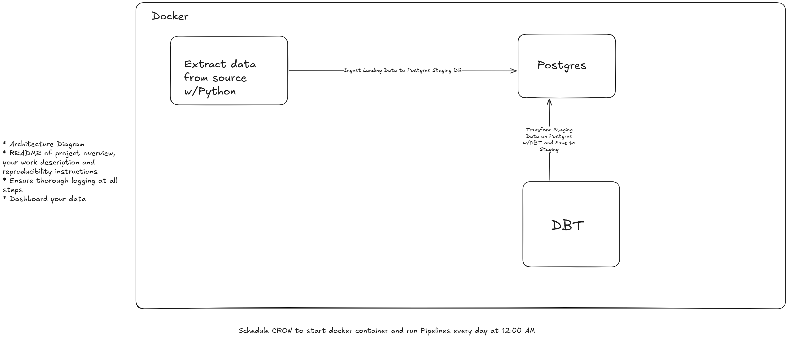

# Dockerizing Simple ETL Pipeline built-on DBT, Postgres & Python

This project demonstrates how to Dockerize a simple ETL pipeline using Python, PostgreSQL, and dbt (Data Build Tool). The goal is to create a fully containerized, reproducible environment for building, transforming, and managing data workflows.

- Python handles the Extract and Load, pulling raw data from a source and loading it into PostgreSQL.
- PostgreSQL serves as the data warehouse, storing both raw and transformed datasets.
- dbt manages the Transform layer, applying SQL-based models, tests, and documentation.

Docker Compose orchestrates the services, ensuring consistent and isolated environments for development and testing.

With this setup, you can spin up an end-to-end data pipeline using a single command — making it easy to experiment, collaborate, and deploy without dependency issues.



#### Pushing images to Docker Hub
To push your image to a Docker Repository, you first need to tag that local image with a addressable image format, `<docker_hub_registry>/<repository_name>:<tag>` and in the case of docker the "docker_hub_registry" is "docker.io".

So If I have a local image, named `extract-data:latest`. First I create a docker hub repository named `cde-extract-etl-data` under my account `temmyzeus`.

```bash
docker tag extract-data:latest docker.io/temmyzeus/cde-extract-etl-data:latest
docker push temmyzeus/cde-extract-etl-data:latest
```
## Environment Variables
### python-data-extract
Create a `.env` file in the rott folder of this project with the variables below defined
```bash
POSTGRES_HOST=
POSTGRES_USER=
POSTGRES_PASSWORD=
POSTGRES_DB=
```
### postgres
### dbt


```
docker compose -f docker-compose.yaml up
```
